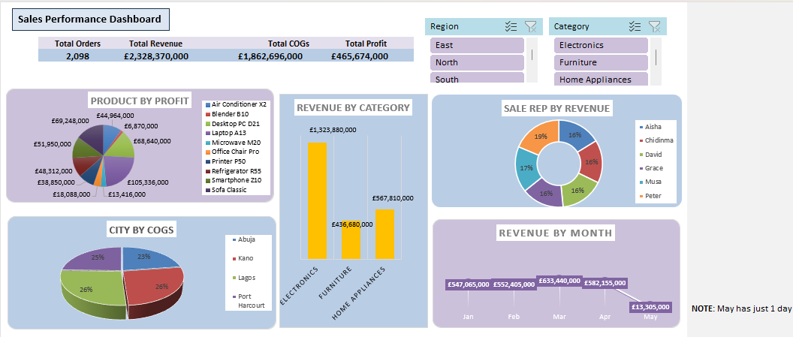

# Sales-Performance-Dashboard-Excel
## Objective

To help a sales manager see which products, sales reps, cities and regions drive revenue and profit, using a dashboard that can be filtered by region and category.

## Overview

This project analyses 2,098 sales transactions from January to early May 2025 for a retail business selling electronics, furniture and home appliances across four Nigerian cities (Lagos, Kano, Abuja and Port Harcourt). The goal was to calculate core business KPIs, identify top performers, and present the results in an interactive Excel dashboard.

   
   
   **Download the Excel file:** [Sales_Performance_Dashboard.xlsx](https://1drv.ms/x/c/9211CDC3FC9B8699/IQD_RAwT3CctSqm0fI0gjJH-AbBTKih4ODRb3q3tKGiqUgM?e=JQCsCL)
   
**Tools used:** Excel Tables, Power Query, calculated columns, PivotTables, Pivot Charts, Slicers and a dashboard layout.

**Data source:** Data Analytics/TS Academy, *Project Curriculum*

## Data and Preparation

This dataset holds 15 fields, including date, region, city, customer type, channel, product, category, unit price, quantity and sales rep. I checked it for quality issues and found none: no missing values, no duplicate records, and no zero or negative quantities or prices.

I converted the data into an Excel Table and added calculated columns:

- **Cost Price:** 80% of unit price
- **Revenue:** quantity × unit price
- **COGS:** quantity × cost price
- **Profit:** revenue − COGS
- **Month:** extracted from the date

## Key Metrics

| KPI | Value |
|---|---|
| Total Revenue | £2,328.4M |
| Total COGS | £1,862.7M |
| Total Profit | £465.7M |
| Profit Margin | 20% |
| Total Orders | 2,098 |

## Key Findings

**Most profitable product:** Laptop A13 earned £105.3M in profit, about 23% of the total. Sofa Classic (£69.2M) and Desktop PC D21 (£68.6M) followed. Blender B10 was the lowest at £6.9M.

**Top sales rep by revenue:** Peter led with £434.8M, ahead of Musa (£397.7M). The other four reps were close together, between £367.8M and £378.7M.

**Cost by city:** Lagos had the highest COGS (£493.8M), followed by Kano (£486.8M), Port Harcourt (£458.8M) and Abuja (£423.3M).

**Monthly performance:** Revenue peaked in March (£633.4M). January was the weakest full month for revenue (£547.1M) and February for order volume (499 orders). The dataset ends on 1 May, so May is a partial month.

**Category mix:** Electronics generated 57% of revenue (£1,323.9M), well ahead of Home Appliances and Furniture.

**Region:** East was the top region (£643.2M, 27.6% of revenue) and South the lowest (£529.8M, 22.8%).

## Dashboard

The dashboard combines KPI cards with five charts (profit by product, revenue by category, revenue by sales representatives, COGS by city and revenue by month), all driven by PivotTables. Two slicers, Region and Category, allow stakeholders filter every chart at once.

## Insights

- Profit margin is a constant 20% across all products, so profit rankings come from sales volume and price, not margin differences. A pricing or discount analysis would be a useful next step.
- High-priced electronics dominate both revenue and profit, so inventory and promotion decisions should focus there.
- Sales representative revenue is fairly evenly distributed, with Peter ahead by a clear but modest margin.
